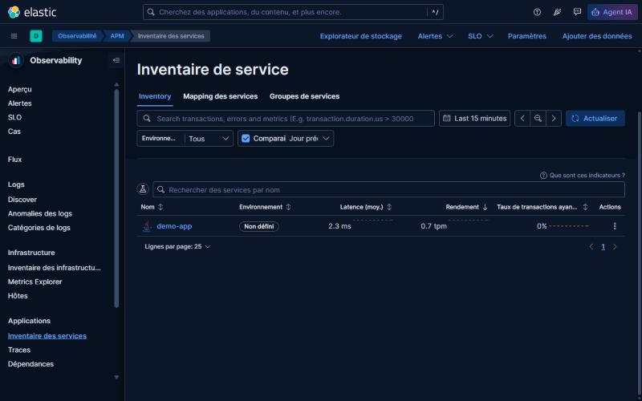
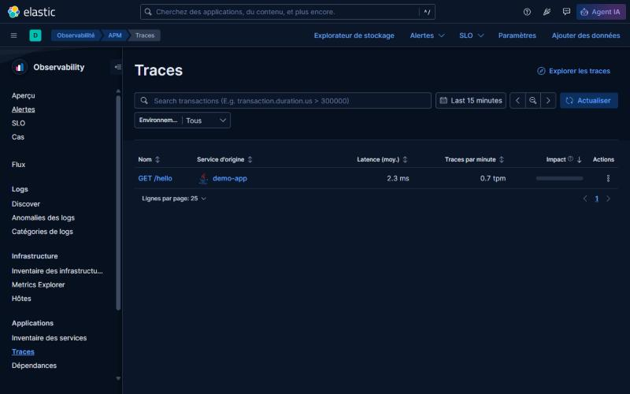

# Quarkus Observability Dev Services Elastic

This extension provides an Elastic observability stack for Quarkus dev/test and publishes a default OTLP endpoint:

- Elasticsearch
- Kibana
- Elastic APM Server
- OpenTelemetry Collector
- `quarkus.otel.exporter.otlp.endpoint` set to the stack OTLP gRPC host endpoint

## Quarkus Dev Services behavior

Orchestration follows standard Quarkus Dev Services flow:

- `quarkus.compose.devservices.enabled=true` -> Compose Dev Services path
- otherwise -> Testcontainers path

Compose file precedence in Compose mode:

1. `quarkus.compose.devservices.files` from the consuming app
2. `quarkus.observability.devservices.elastic.compose.files`
3. extension-generated compose file under `target/quarkus-devservices/elastic/compose-devservices.yml`

When Compose mode is enabled, this extension does not fall back to Testcontainers.

Generated Compose assets are written to `target/quarkus-devservices/elastic/`.

## Modules

- `runtime`: extension config model and metadata
- `deployment`: Dev Services startup logic and generated Compose assets
- `integration-tests`: endpoint reachability checks for JVM and packaged tests
- `docs`: Antora documentation sources

## Build and verification

```bash
cd quarkus-observability-devservices-elastic
mvn clean install
```

Run container-backed extension tests:

```bash
cd quarkus-observability-devservices-elastic
mvn clean install -DskipExtensionTests=false
```

## Use in an app

```xml
<dependency>
  <groupId>io.quarkiverse.observability</groupId>
  <artifactId>quarkus-observability-devservices-elastic</artifactId>
  <version>1.0.0-SNAPSHOT</version>
</dependency>
```

## Configuration

Main prefix: `quarkus.observability.devservices.elastic`.

Core keys:

- `enabled=true`
- `reuse=false` (Testcontainers mode)
- `elasticsearch-image=elasticsearch:9.5.5`
- `kibana-image=kibana:9.5.5`
- `apm-server-image=elastic/apm-server:9.5.5`
- `otel-collector-image=otel/opentelemetry-collector-contrib:0.164.0`
- `otel-collector-config=` (optional custom collector YAML)
- `elasticsearch-port=9200`
- `kibana-port=5601`
- `apm-server-port=8200`
- `otlp-grpc-port=4317`
- `otlp-http-port=4318`
- `compose.files=` (optional extension compose file path)
- `compose.project-name=observability-elastic`

In Compose mode a busy host port only logs a warning; Docker reports the real failure.

In Testcontainers mode the ports actually used are exposed as `observability.devservices.elastic.resolved.{elasticsearch,kibana,apm-server,otlp-http}-port`.

Only host-published ports are configurable. Internal service communication always stays on:

- Kibana -> `http://elasticsearch:9200`
- APM Server -> `http://elasticsearch:9200` and `http://kibana:5601`
- Collector -> `http://apm-server:8200`

## Port policy (Testcontainers mode)

- Reuse only when all expected host ports are already bound by matching stack images (full-stack atomic reuse).
- Fail fast when only part of the expected stack is already running on matching image ports.
- Fail fast when an explicitly configured port is occupied by a different image/process.
- Auto-pick another free port when a default (not explicitly configured) port is occupied.

## Compose mode example

```yaml
quarkus:
  compose:
    devservices:
      enabled: true
      project-name: projectname
  observability:
    devservices:
      elastic:
        enabled: true
        compose:
          files: ./src/main/compose/compose-devservices.yml
```

If you provide custom compose files, keep published host ports aligned with `quarkus.observability.devservices.elastic.*-port` so the generated OTLP endpoint remains accurate.

## Try it

Minimal app: add `quarkus-rest`, `quarkus-opentelemetry` and this extension, then use the Testcontainers path:

```properties
quarkus.application.name=demo-app
quarkus.compose.devservices.enabled=false
# quarkus-opentelemetry also starts the Grafana LGTM dev service by default; turn it off to keep only the Elastic stack
quarkus.observability.lgtm.enabled=false
```

Run `mvn quarkus:dev`, call an endpoint a few times (`curl localhost:8080/hello`) and open Kibana at `http://localhost:5601`
(Observability > Applications). The first start pulls the Elastic images, which can take several minutes.

Verified locally with Quarkus 3.40.1 and Docker 26.1: Elasticsearch (9200), Kibana (5601), APM Server (8200) and the OTel Collector start,
and the app's traces show up in Kibana APM.





(Screenshots taken with a French-language browser, hence the French Kibana UI.)

## Documentation

- Docs source: `docs/`
- Published guide: `https://docs.quarkiverse.io/quarkus-observability-devservices-elastic/dev/`

## Release readiness

- Track repository and process readiness in `RELEASE_READINESS.md`.

